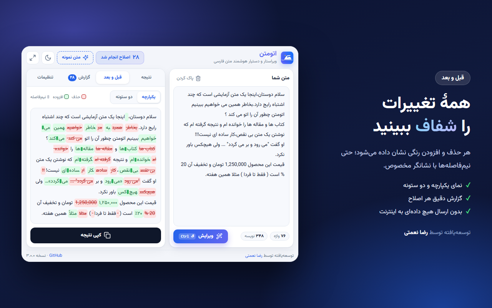
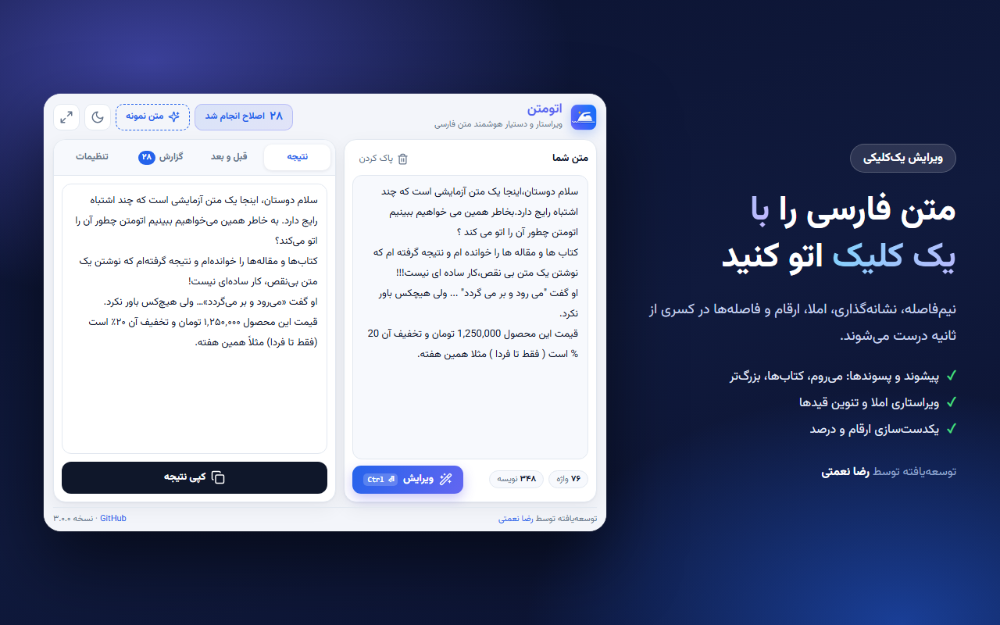
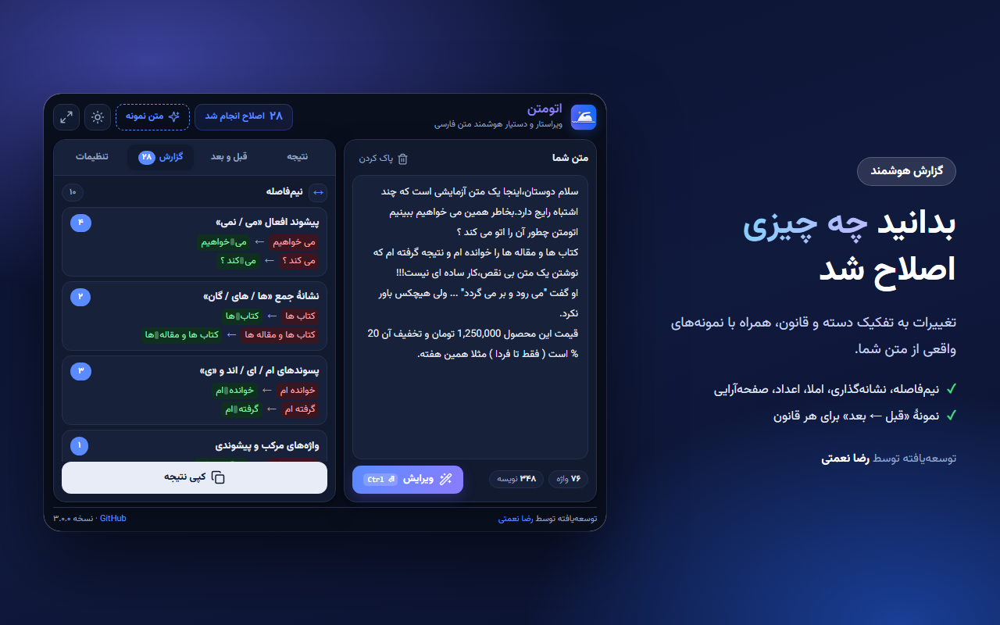
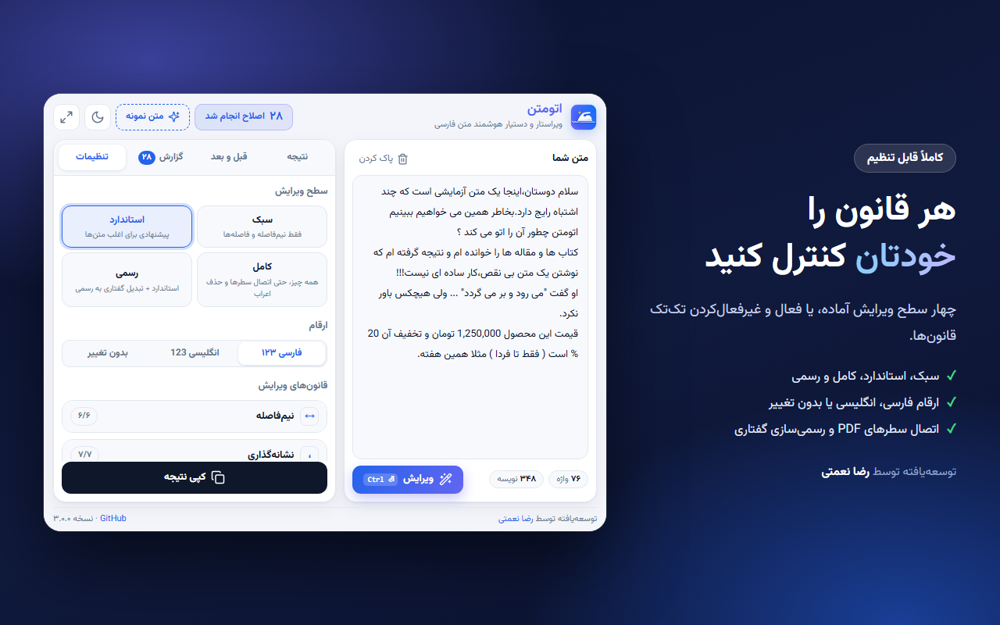
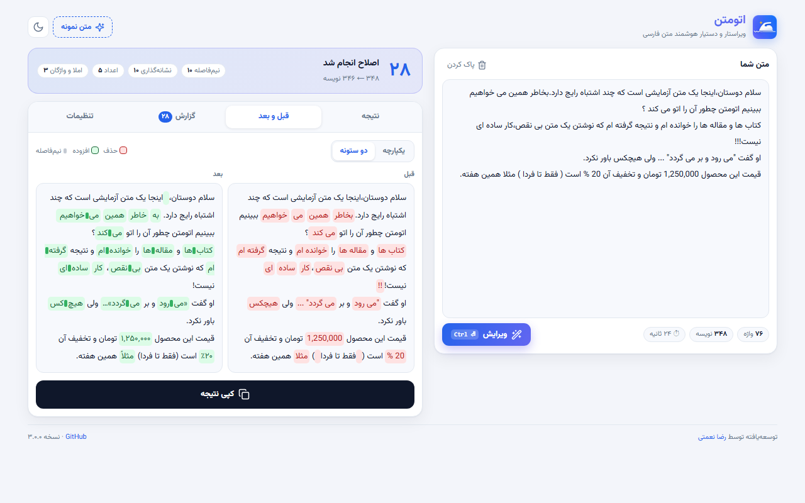

<div align="center">


# اتومتن | Otomatn

**ویراستار و دستیار حرفه‌ای متن فارسی — با یک کلیک**

نیم‌فاصله، نگارش، نشانه‌گذاری، املا، ارقام و صفحه‌آرایی؛ همه در یک کلیک، کاملاً آفلاین و بدون ارسال هیچ داده‌ای.

[](CHANGELOG.md)
[](#-لایسنس)
[](#-نصب)
[](#-نصب)
[](PRIVACY.md)

**🌐 [سایت و دانلود: mr-shady.github.io/halfspace](https://mr-shady.github.io/halfspace/)**

توسعه‌یافته توسط **[رضا نعمتی](https://reza-nemati.ir)**

<br>



</div>

---

## ✨ اتومتن چه می‌کند؟

متن فارسی را انتخاب کنید (یا بچسبانید)، روی **«ویرایش یک‌کلیکی»** بزنید و **قبل و بعد** را کنار هم ببینید.

| دسته | نمونهٔ اصلاح |
|---|---|
| **نیم‌فاصله** | `می رود` ← `می‌رود` · `کتاب ها` ← `کتاب‌ها` · `رفته ام` ← `رفته‌ام` · `بزرگ تر` ← `بزرگ‌تر` · `بی نظیر` ← `بی‌نظیر` · `کننده گان` ← `کنندگان` |
| **نشانه‌گذاری** | `سلام ،خوبی ؟` ← `سلام، خوبی؟` · `"متن"` ← `«متن»` · `!!!` ← `!` · `...` ← `…` · `,` `;` `?` ← `،` `؛` `؟` |
| **یکسان‌سازی** | `ي ك` ← `ی ک` · حذف کشیده و نویسه‌های نامرئی · نویسه‌های نمایشی عربی (متن کپی‌شده از PDF/ورد) · `سلاااام` ← `سلام` |
| **اعداد** | `123` ← `۱۲۳` · `1,500,000` ← `۱٬۵۰۰٬۰۰۰` · `3.14` ← `۳٫۱۴` · `50 %` ← `۵۰٪` |
| **املا و واژگان** | `بخاطر` ← `به خاطر` · `بطور` ← `به طور` · `مثلا` ← `مثلاً` · `که که` ← `که` · (اختیاری) `نمیدونم` ← `نمی‌دانم` |
| **صفحه‌آرایی** | فاصله‌های اضافی · خط‌های خالی · `نسخهWindows` ← `نسخه Windows` · (اختیاری) اتصال سطرهای شکستهٔ PDF |

> لینک‌ها، ایمیل‌ها، نام‌های کاربری، مسیر فایل‌ها و کدها (`` `code` ``) **هرگز دست نمی‌خورند**؛ همچنین اعداد داخل متن لاتین (`H2O`، `mp3`، `v2.0.1`).

## 🖼️ تصاویر

<table>
<tr>
<td width="50%"></td>
<td width="50%"></td>
</tr>
<tr>
<td></td>
<td></td>
</tr>
</table>

## 🚀 قابلیت‌های نسخهٔ ۳

- **قبل و بعد** — نمای یکپارچه (حذف/افزودن رنگی) و دو ستونه؛ حتی نیم‌فاصله‌ها با نشانگر مخصوص دیده می‌شوند.
- **گزارش هوشمند** — تعداد اصلاحات به تفکیک دسته و قانون، با نمونهٔ «قبل ← بعد» از خود متن شما.
- **حفظ قالب** — لینک، تصویر، عنوان، پررنگ، فهرست و جدول در ورودی و خروجی حفظ می‌شود؛ فقط خودِ متن ویرایش می‌شود.
- **اصلاح در محل** — در فیلدهای متنی و ویرایشگرها (ایمیل، شبکه‌های اجتماعی، ...) متن را انتخاب کنید و <kbd>Alt</kbd>+<kbd>Shift</kbd>+<kbd>F</kbd> یا راست‌کلیک ← «اصلاح با اتومتن». بدون انتخاب، کل فیلد اصلاح می‌شود.
- **جایگزینی در صفحه** — از پاپ‌آپ، نتیجه را با یک کلیک در همان فیلد جایگزین کنید.
- **۴ سطح ویرایش** — سبک، استاندارد، کامل، رسمی؛ یا فعال/غیرفعال‌کردن تک‌تک ۲۸ قانون.
- **پنجرهٔ بزرگ** — برای متن‌های بلند، با چیدمان دو ستونه.
- **تم روشن/تیره** و فونت وزیرمتن (آفلاین).
- **۱۰۰٪ آفلاین و خصوصی** — هیچ سرور، آنالیتیکس یا حساب کاربری وجود ندارد.

### میان‌برها

| میان‌بر | کار |
|---|---|
| <kbd>Alt</kbd>+<kbd>Shift</kbd>+<kbd>O</kbd> | باز کردن اتومتن |
| <kbd>Alt</kbd>+<kbd>Shift</kbd>+<kbd>F</kbd> | اصلاح متن انتخاب‌شده در همان صفحه |
| <kbd>Ctrl</kbd>+<kbd>Enter</kbd> | ویرایش یک‌کلیکی (در خود افزونه) |

میان‌برها از `chrome://extensions/shortcuts` (کروم) و `about:addons` (فایرفاکس) قابل تغییرند.

## 📦 نصب

بسته‌های آمادهٔ انتشار در پوشهٔ [`releases/`](releases) قرار دارند:

| مرورگر | فایل |
|---|---|
| Google Chrome / Edge / Brave | [`otomatn-chrome-v3.0.0.zip`](releases/otomatn-chrome-v3.0.0.zip) |
| Mozilla Firefox | [`otomatn-firefox-v3.0.0.zip`](releases/otomatn-firefox-v3.0.0.zip) |

**نصب دستی (حالت توسعه‌دهنده):**

- **کروم:** فایل zip را استخراج کنید ← `chrome://extensions` ← **Developer mode** ← **Load unpacked** ← پوشهٔ استخراج‌شده.
- **فایرفاکس:** `about:debugging` ← **This Firefox** ← **Load Temporary Add-on** ← مستقیم فایل `otomatn-firefox-v3.0.0.zip` (بدون نیاز به استخراج یا build). افزونهٔ امضانشده با بستن فایرفاکس برداشته می‌شود؛ برای نصب دائمی باید از AMO منتشر شود، یا در Developer Edition/Nightly گزینهٔ `xpinstall.signatures.required` را `false` کنید.

> راهنمای انتشار در فروشگاه‌ها و متن آمادهٔ ثبت‌نام: [`store/LISTING.md`](store/LISTING.md).

## 🧰 کتابخانهٔ جاوااسکریپت

موتور اتومتن یک کتابخانهٔ مستقل، **بدون وابستگی** و سازگار با مرورگر، Node.js و Service Worker است.

```html
<script src="https://cdn.jsdelivr.net/gh/mr-shady/halfspace/src/core/otomatn-core.js"></script>
<script>
  const { text, total, changes } = Otomatn.refine('این متن می رود و کتاب ها بزرگ تر هستند ،بخاطر همین.');
  console.log(text);  // این متن می‌رود و کتاب‌ها بزرگ‌تر هستند، به خاطر همین.
  console.log(total); // تعداد اصلاحات
</script>
```

```js
// Node.js
const Otomatn = require('./src/core/otomatn-core.js');

Otomatn.refine(input, {
  preset: 'standard',                 // 'minimal' | 'standard' | 'full' | 'formal'
  digits: 'fa',                       // 'fa' | 'en' | 'keep'
  rules: { 'join-lines': true },      // بازنویسی تک‌تک قانون‌ها
});

Otomatn.diff(before, after);          // [{ type: 'eq' | 'del' | 'ins', text }]
Otomatn.analyze(text);                // واژه، جمله، پاراگراف، زمان مطالعه، ...
Otomatn.RULES;                        // فهرست قانون‌ها (شناسه، برچسب، مثال)
```

**سازگاری با نسخه‌های قبلی:** فایل [`FixGrammar.js`](FixGrammar.js) همان API قدیمی (`new FixGrammar(text).get()`) را حفظ می‌کند.

```js
const fixer = new FixGrammar('این متن نیاز به اصلاح نیم فاصله دارد.');
fixer.get(); // این متن نیاز به اصلاح نیم‌فاصله دارد.
```

### فهرست قانون‌ها

<details>
<summary>۲۸ قانون ویرایش (کلیک کنید)</summary>

| شناسه | توضیح | پیش‌فرض |
|---|---|:-:|
| `verb-prefix` | پیشوند افعال «می / نمی» | ✅ |
| `plural-suffix` | نشانهٔ جمع «ها / های / گان» | ✅ |
| `participle-suffix` | پسوندهای ام / ای / اند و «ی»، «گم‌شده» | ✅ |
| `comparative` | صفت تفضیلی «تر / ترین» | ✅ |
| `compound-words` | واژه‌های مرکب و پیشوندی (بی‌، هیچ‌، پس‌زمینه، ...) | ✅ |
| `zwnj-cleanup` | پاک‌سازی نیم‌فاصلهٔ اضافی | ✅ |
| `punct-language` | `, ; ?` ← `، ؛ ؟` | ✅ |
| `punct-spacing` | فاصله قبل و بعد نشانه‌ها | ✅ |
| `punct-repeat` | `!!!` `؟؟؟` | ✅ |
| `ellipsis` | `...` ← `…` | ✅ |
| `quotes` | `"..."` ← `«...»` | ✅ |
| `brackets` | فاصله در پرانتز و گیومه | ✅ |
| `dashes` | `--` ← `—` | ✅ |
| `unicode-forms` | نویسه‌های نمایشی عربی | ✅ |
| `arabic-letters` | `ي ك ى` ← `ی ک ی` | ✅ |
| `invisible-chars` | کشیده، RLM/LRM، فاصلهٔ سخت | ✅ |
| `elongation` | `سلاااام` ← `سلام` | ✅ |
| `diacritics` | حذف اعراب | ❌ |
| `spaces` | فاصله‌های اضافی | ✅ |
| `blank-lines` | خط‌های خالی اضافی | ✅ |
| `script-spacing` | فاصله بین فارسی، لاتین و عدد | ✅ |
| `join-lines` | اتصال سطرهای شکسته (PDF) | ❌ |
| `digits` | یکدست‌سازی ارقام | ✅ |
| `number-format` | هزارگان، اعشار، درصد | ✅ |
| `spelling` | اشتباهات املایی رایج | ✅ |
| `tanvin` | تنوین قیدها (مثلاً، حتماً) | ✅ |
| `duplicate-words` | حذف واژهٔ تکراری | ✅ |
| `formalize` | رسمی‌سازی گفتاری | ❌ |

</details>

## 🏗️ ساختار پروژه

```
src/core/otomatn-core.js     موتور ویرایش (UMD، بدون وابستگی)
src/extension/               کد مشترک افزونه (پاپ‌آپ، پس‌زمینه، اسکریپت صفحه)
  manifest.chrome.json       Manifest V3 برای Chrome / Edge
  manifest.firefox.json      Manifest V3 برای Firefox
scripts/build.mjs            ساخت dist/ و بستهٔ zip هر دو مرورگر
scripts/screenshots.mjs      تولید تصاویر معرفی با مرورگر headless
test/core.test.js            تست‌های خودکار موتور (node:test)
store/                       متن آمادهٔ فروشگاه‌ها + تصاویر
php/                         نسخهٔ PHP (قدیمی)
```

```bash
npm test               # اجرای تست‌ها
npm run build          # ساخت dist/ و releases/*.zip
npm run screenshots    # تولید مجدد تصاویر
npm run serve          # پیش‌نمایش پاپ‌آپ: http://localhost:5173/dist/chrome/popup/popup.html?sample=1
```

فقط Node.js ≥ ۲۲٫۲ لازم است؛ هیچ بسته‌ای نصب نمی‌شود.

## 🔒 حریم خصوصی

اتومتن کاملاً **آفلاین** است: متن شما هرگز از مرورگرتان خارج نمی‌شود، هیچ ردیاب یا آنالیتیکسی وجود ندارد و فقط تنظیمات شما به‌صورت محلی ذخیره می‌شود. جزئیات در [PRIVACY.md](PRIVACY.md).

## 🗺️ نقشهٔ راه

- [ ] واژه‌نامهٔ شخصی (استثناها)
- [ ] تشخیص ساختار پاراگراف در متن‌های بلند
- [ ] نسخهٔ Safari

## ✉️ بازخورد

پیشنهاد، انتقاد یا باگ؟ [Issue](https://github.com/mr-shady/halfspace/issues) باز کنید یا به reza.shady@gmail.com ایمیل بزنید.

## 📄 لایسنس

[MIT](https://choosealicense.com/licenses/mit/) — © [رضا نعمتی](https://reza-nemati.ir)
